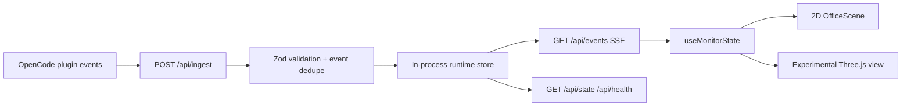
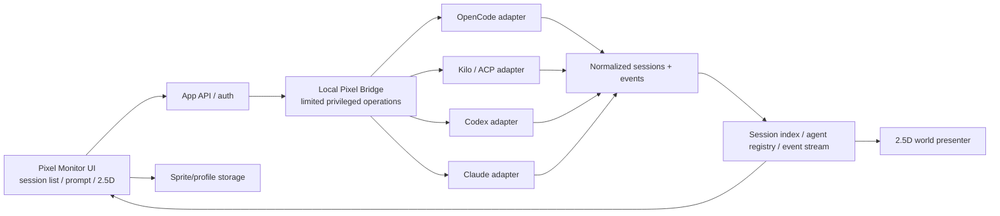

# Pixel Monitor — Architecture & Application Flow

**Updated:** 2026-10-09 · **Scope:** essential technical reference (also replaces a separate TRD, app-flow doc and database-schema doc)

> **Evidence:** **Current/verified** sections describe the GitHub `master` snapshot last pushed 2026-09-10. Later local Phase 4 implementation is **owner-reported but not directly inspected**. Everything under **Target/proposed** is a design to validate, not working code. The local tree overrides this snapshot when evidence conflicts.

## 1. Principles

1. **Provider owns execution.** Pixel Monitor sends authorized requests and renders reported state; it is not the agent's source of truth.
2. **One normalized model, adapters at edges.** Provider-specific differences remain visible through capabilities and provenance.
3. **No fabricated events.** Unknown actor, unknown outcome and unsupported action remain explicit.
4. **Keep monitoring independent from presentation.** UI mode switching cannot create synthetic arrivals, invocations or sessions.
5. **Local control is privileged.** Browser UI does not execute arbitrary commands or connect directly to arbitrary desktop processes.
6. **Persist only what we own.** Provider session history belongs to provider; Pixel Monitor owns preferences, visual profiles, registered identities and optional event replay cache.

## 2. Current architecture — verified in GitHub snapshot



- `src/lib/schema.ts` accepts ingest payloads `v: 1` and `v: 2`. V2 includes session IDs, root/parent relationships, actors and invocation updates.
- `src/lib/monitor-store.ts` tracks sessions, floors, actors, invocations, epoch/sequence, replay events and event deduplication.
- `src/lib/monitor-types.ts` defines current `SessionInfo`, `FloorInfo`, `ActorInfo`, `InvocationInfo` and snapshot/delta envelopes.
- `src/app/api/events/route.ts` publishes authenticated SSE initial snapshots, replay and ongoing snapshots; `src/hooks/useMonitorStream.ts` consumes the stream.
- `src/app/page.tsx`, `OfficeScene.tsx`, `CharacterSprite.tsx` and `SceneViewport.tsx` render the current pixel office. The GitHub snapshot includes `ThreeCanvas.tsx` and Three.js modules as a separate experimental renderer.
- The current 2D office is positioned/layered pixel art, **not a confirmed isometric 2.5D projection**.
- There are routes for renaming and closing a monitor floor; these are **not** equivalent to controlling or stopping a provider session.
- A Supabase migration/flag exists, but the inspected ingest/runtime path is an in-process store. Future persistent storage is not settled.

**Known constraints:** The inspected `GET /api/events` accepts a token from the URL query and the UI uses a `NEXT_PUBLIC_*` value. This is **not secure authentication for remote process control**. The server also has a development token fallback. Keep the existing deployment local until auth is reworked.

## 3. Target architecture — proposed, not implemented



This is a **logical separation**, not a requirement to create microservices. Start with a local bridge module/sidecar only when a privileged operation makes it necessary. Providers may have distinct transport/protocols; do **not** assume all have ACP or identical operations. Validate implementation against the installed CLI/version before committing to an adapter.

### Responsibilities

| Component | Does | Does not |
|---|---|---|
| Web UI | Select workspace/provider/session, send intent, inspect outputs, customize appearances | Run arbitrary shell commands |
| Local bridge (proposed) | Manage allowed local process/provider connections, session actions, PTYs where supported | Scrape every desktop app's private conversation |
| Provider adapter | Translate supported session/message/event/cancel actions | Invent unsupported capabilities |
| Normalizer | Produce stable session/actor/invocation identities with provenance | Infer unknown names from UI labels |
| Runtime state/stream | Reconcile snapshots/events idempotently | Own the provider's true execution state |
| Visual layer | Animate observed state | Convert view switches into real arrivals |
| Asset/profile storage | Validate packs and persist visual associations | Modify provider configuration implicitly |

## 4. Application flows

### Session control (planned)

```mermaid
sequenceDiagram
  participant U as User
  participant UI as Pixel Monitor UI
  participant B as Local Bridge
  participant P as Provider
  U->>UI: Choose provider, workspace, session
  UI->>B: List/get sessions
  B->>P: Supported provider API action
  P-->>B: Session data / capabilities
  B-->>UI: Normalized session list
  U->>UI: Send prompt to selected session
  UI->>B: Prompt request with action id
  B->>P: Provider-supported prompt operation
  P-->>B: Ack / events / messages
  B-->>UI: State + transcript updates
  Note over UI,P: On reconnect, reconcile by IDs; never auto-resubmit a prompt
```

### Dynamic agent identity (planned)

`provider event/agent list → map provider + workspace + agent key → register declared/observed identity → choose persisted visual profile or fallback sprite → world renderer`. Anonymous child sessions remain labeled unknown until reliable metadata arrives.

### Optional terminal attach (planned)

`Open terminal` means **attach to the selected provider session if its transport supports it**. Opening a new CLI process does not automatically attach to or reproduce an existing session. Show a capability warning rather than spawning a misleading fresh session. Prefer dedicated PTY access when genuinely needed; use approved commands/arguments only.

### World lifetime

The runtime model survives switching views. Existing actors in an initial snapshot **hydrate** to the current logical state; only newly observed transitions trigger real-time entrance effects. Renderer lifecycle and provider lifecycle are separate. A deferred 3D view can remain behind a feature flag without dictating the new world model.

## 5. Essential data model

These are **conceptual entities**, **not a finalized SQL schema**. Reuse current monitor types where possible; do not require a database redesign simply to document this.

| Entity | Essential identity and relationships | Source / persistence |
|---|---|---|
| `ProviderConnection` | `providerId`, workspace/scope, status, supported capabilities | Local bridge configuration (planned) |
| `Project` | normalized project/workspace key, display path/name | Provider/discovery; cache optional |
| `Session` | composite `providerId + workspaceId + nativeSessionId`; optional parent/root ID; lifecycle | Provider-owned; index/cache optional |
| `AgentDefinition` | `providerId + nativeAgentKey`, display name, declared or observed provenance | Persist registry (planned) |
| `ActorInstance` | agent definition + session + runtime actor ID; observed state | Event-derived runtime state |
| `Invocation` | stable native call/task ID, sender/recipient (nullable), parent invocation, status/outcome | Event-derived state; replay optional |
| `NormalizedEvent` | stable event key, provider, occurredAt/receivedAt, type, raw reference, provenance | Short replay buffer; durable history optional |
| `SpritePack` | pack ID, version, asset file refs, validated dimensions/poses | User-owned local asset storage (planned) |
| `VisualProfile` | profile ID, spritePackId, display preferences | User-owned local persistence (planned) |
| `AgentVisualAssignment` | `providerId + nativeAgentKey` → visualProfileId; optional workspace override | User-owned local persistence (planned) |

**Relationships:** `Project 1→many Session`; `Session` may link to parent/children; `Session 1→many ActorInstance`; `Invocation` optionally links sender, recipient and parent invocation; `AgentDefinition many→1 VisualProfile` is allowed, without conflating provider identities.

**Important:** Current monitor IDs (`deriveFloorId`, `deriveActorId`, `deriveInvocationId`) do not include provider namespace. Add a provider-scoped identity strategy *before* multi-provider ingestion, with compatibility/migration for existing OpenCode sessions.

### Persistence decision — defer until needed

- **Now:** preserve the in-process monitor store and its live SSE semantics.
- **Before user-uploaded sprites:** choose a safe local directory for image blobs and a small persistent index for packs/assignments.
- **Before controllable session browser:** persist minimal provider connection/user preferences if necessary; request current history from each provider, don't mirror conversations by default.
- **Candidate:** SQLite for compact local metadata; **not selected yet**. Existing Supabase code/migration should be audited, not assumed to power the new control plane.

## 6. Adapter capabilities (contract sketch, not final code)

Each adapter exposes a descriptor of supported operations and limitations:

```ts
// Illustrative interface only; refine from a real OpenCode spike.
type ProviderCapabilities = {
  listSessions: boolean;
  createSession: boolean;
  loadSession: boolean;
  sendPrompt: boolean;
  interrupt: boolean;
  streamEvents: boolean;
  listAgents: boolean;
  attachTerminal: boolean;
};

interface ProviderAdapter {
  id: string;
  capabilities(): Promise<ProviderCapabilities>;
  // Individual operations must be capability-checked and typed.
}
```

Return typed `unsupported` / `not-configured` errors rather than placeholders. Map each provider's native ID into stable normalized references; keep raw provider IDs for round-trip API calls. ACP, app-server and process handling are candidates to test, not blanket assumptions about all tools.

## 7. Security and privacy boundary

- Bind any privileged bridge to loopback; validate origin, require a non-public credential/session binding, protect against local CSRF and drive-by-webpage access. A `NEXT_PUBLIC_*` token must **never** authorize arbitrary local command execution.
- Whitelist provider executable/approved arguments and validate workspace roots; no generic shell string endpoint.
- Require explicit user action for prompt submission, process launch/termination, destructive file/workspace actions and provider interrupt.
- Stream process data through a controlled, bounded channel; scrub credentials, minimize prompt/log retention, and avoid logging full command lines if they contain secrets.
- Validate PNG dimensions, decoding, file size and manifest; keep uploaded packs outside tracked `public/` and never execute uploaded code.
- Build for offline/local use first. Remote access, team accounts, cloud sync and multi-machine process control require a separate security design.

## 8. Engineering constraints and gates

- Keep a single monitoring subscription per app view; stable IDs for diff/reconcile; dedupe on reconnect.
- Limit file/asset sizes, worker processing and replay ring length; cap browser rendering cost with many actors.
- Accessibility: keyboard selection, informative status text, focus restoration, reduced motion and mobile viewing.
- Test each adapter with mock fixtures *and* an isolated real session. Browser tests cover multi-session, fallback actors, view switching, mobile and leaks.
- Never destroy a working renderer until parity tests on the replacement pass. Keep 3D dormant rather than deleting modules without reference audit.

## 9. Where to implement

**Current:** `src/lib/monitor-types.ts`, `monitor-store.ts`, `schema.ts`, `hooks/useMonitorStream.ts`, `src/app/api/*`, `components/scene/*`.

**Future, suggested only:** isolate `providers/`, `bridge/`, `registry/`, `visual-profiles/` modules under an appropriate existing server/client separation; use `docs/DESIGN.md` for rendering contracts. Do not create empty framework folders as a documentation task.

For product priorities read [PRD.md](PRD.md); for exact steps read [../PLAN.md](../PLAN.md).
